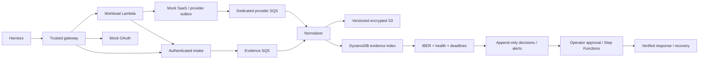

# Architecture walkthrough

This is the current implementation candidate, not a deployed diagram. Full graph: ../architecture/final.mmd. Exact generated resources: ../release/*-inventory.json.



```mermaid
sequenceDiagram
 participant H as Harness
 participant G as Gateway
 participant A as Application
 participant P as Provider
 participant E as Evidence pipeline
 participant R as IBER
 participant O as Operator workflow
 H->>G: Normal request
 G->>E: Expected invocation/action
 G->>A: Disposable scoped token + context
 A->>P: Legitimate resource request
 P->>E: Independent provider audit
 A->>E: App security event (unless suppressed)
 E->>R: Validated archived observations
 R->>R: Deadline + binding + health evaluation
 H->>P: Controlled replay from separate harness
 P->>E: Independent replay observation
 Note over A,E: Suppression omits app security event only
 E->>R: Replay evidence; source health
 R->>E: Suspicious or inconclusive decision revision
 O->>R: Inspect current evidence-backed finding
 O->>P: Approved revoke, then verify rejection
 O->>P: Separately approved fresh-token recovery
 P->>E: Verification observations
```

Security owns provider evidence, archive, keys and detector; workload role cannot alter them. Two-account deployment separates administrators when approved; same-account roles only provide an IAM boundary within one administrative account. Provider independence assumes its control plane remains outside workload compromise. SQS absorbs retries, DynamoDB supports lookup/current state and S3 preserves exact evidence versions. Encryption protects stored data, not source truth. Conditional writes and DLQs address partial failures. Source health reports availability rather than perfect historical coverage. Retention, scheduling bounds and administrator compromise are explicit limits.
